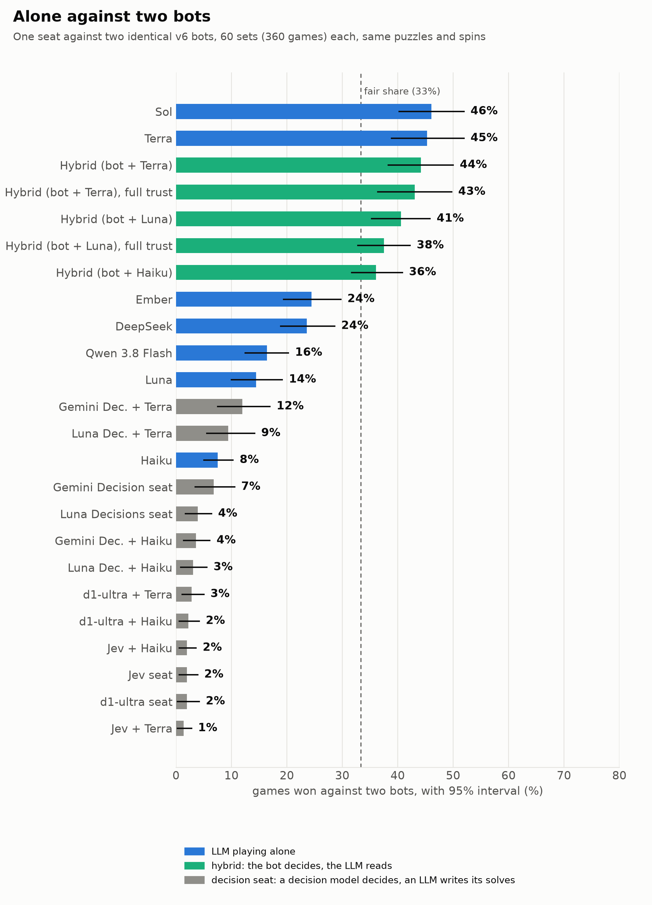
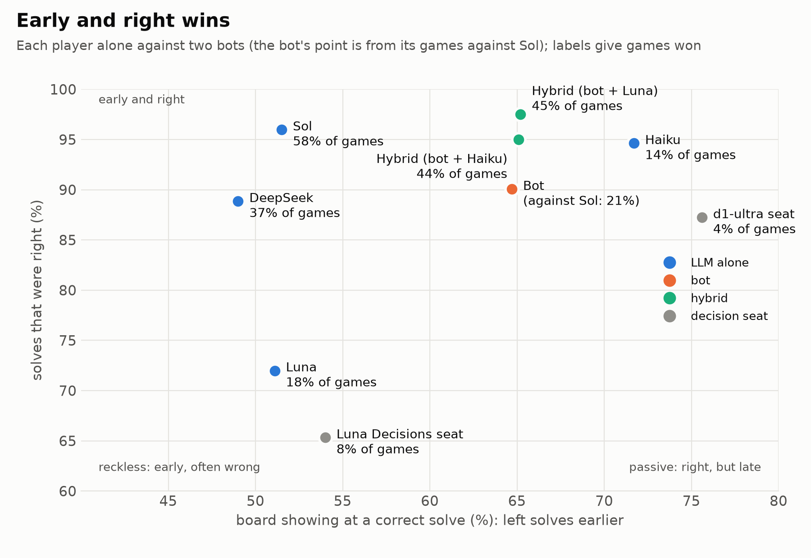
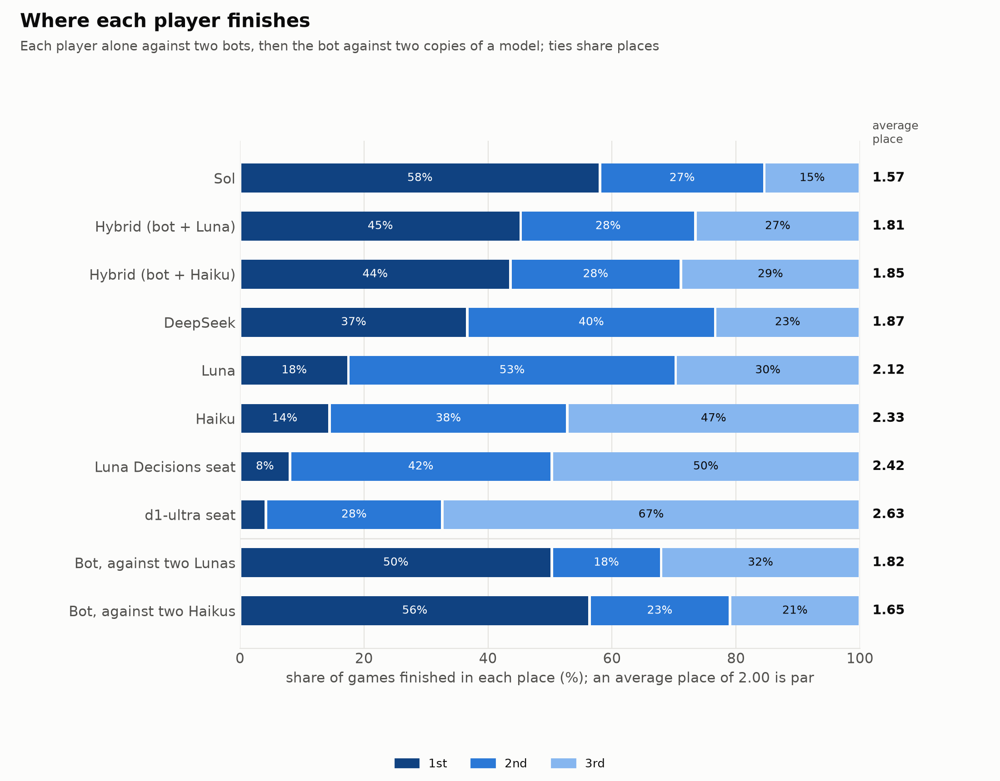
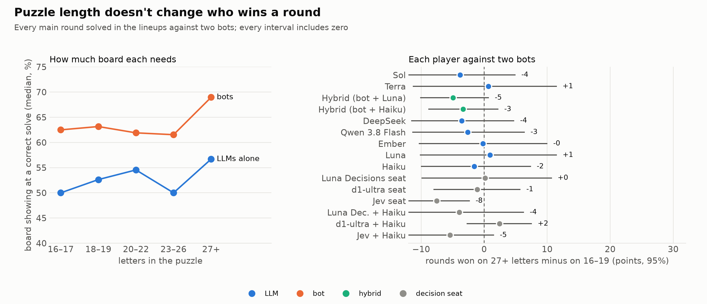
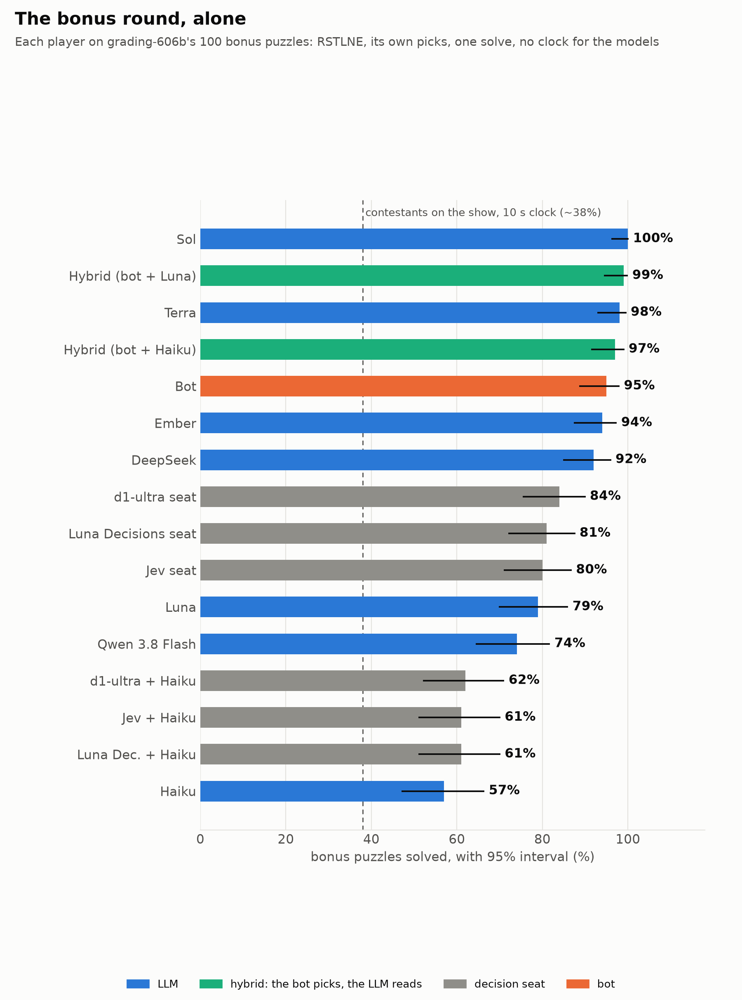
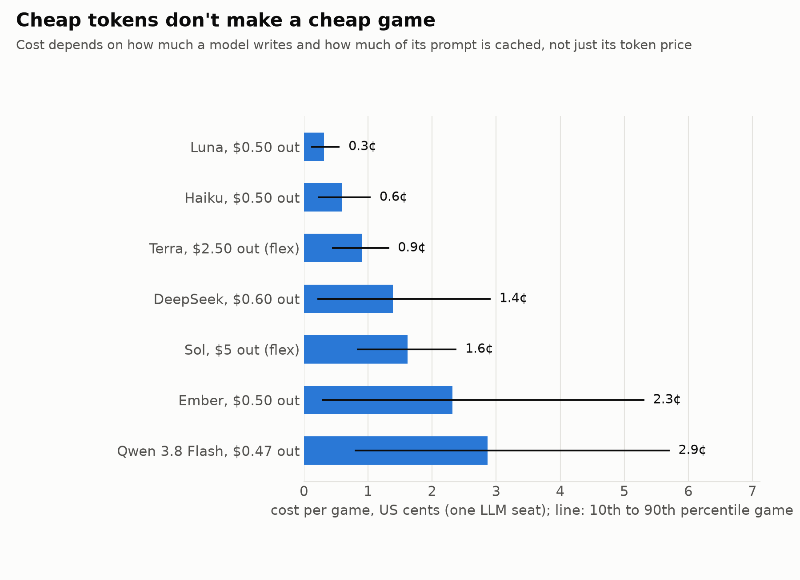

# Findings

Ian grew up watching *Wheel of Fortune* at dinner, every day for years. When large language models arrived, he wondered whether a model trained on the internet, and strong at language, could play his childhood game show. If it could, how well? And could we build something that plays better?

rstlne is the result: a full Wheel of Fortune engine where language models, a hand-built bot, and combinations of the two sit at the same table. It asks four questions:

1. Can LLMs play it?
2. How well do they play?
3. Can we do better?
4. How would human contestants fare? We had no human players, so the models stand in for them, and real contestants' numbers are used where they exist.

> Every result here was measured against version 4 of our bot, the version these findings are frozen on (the v4 checkpoint, 2026-11-01). A later bot version counts as a new opponent. Its results are reported separately, marked with its version, and never replace these numbers.

## The short version

- Models can play. Every model finished every game legally, moving by tool calls.
- The best model beats our bot, but most don't. GPT-6.1 Sol won 58% of games alone against two bots, where a fair share is 33%. DeepSeek V4.1 Flash tied the bots. GPT-6 Luna and Claude Haiku 5.5 lost to them clearly.
- Models have temperaments. Luna guesses early and is often wrong. Haiku is almost always right but waits too long. Sol is early *and* right, and it's the only one that beats the bots.
- **Letting the model read and the bot decide lifts weak models by about 28 points.** It does so for models from two labs with opposite faults: Luna went from 17.5% to 45%, and Haiku from 14% to 44%.
- Handing those decisions to a "decision model" made things worse, including the model ranked first on a published decision index.
- At the bonus round, models far outscore contestants, though without the contestants' 10-second clock. A probe found no sign that they remember aired puzzles.

## How we tested

### The game

The engine runs the show's current rules: a 24-wedge wheel that changes each round, Bankrupt and Lose a Turn, Free Play, the Mystery, Express, Wild Card and Million wedges, buying vowels at $250, and the bonus round, which gives R S T L N E plus three consonants and a vowel of the player's choice. A few rules differ from the show on purpose. Models get one solve response with no clock, which is the biggest difference. Toss-ups are left out because they're a recognition race, and this project measures letter choice, risk, and timing. From round 4, the previous round's solver starts the next one.

### The players

| Player | What it is |
|---|---|
| LLM | A model called through OpenRouter. It sees the board, the letters used, every bank, the wheel, and its legal moves, and moves by tool call. Its system prompt gives the rules and the goal, with no strategy advice: these are models "in the wild". |
| Bot | Our own player, no LLM inside. It reads the board with word, phrase and name lists drawn from Wikipedia, Wiktionary and Wikidata. It scores every move with one value function: dollars in rounds 1 and 2, then its chance of finishing first, including the odds that an opponent steals the round. |
| Hybrid | The bot makes every move. On its turns it asks an LLM, "Can you solve this, and what's the answer?", and decides how far to trust the reply from curves measured beforehand on practice boards. |
| Decision seat | A decision model (a model built to choose among options) makes every move, including when to solve. An LLM writes the answer. |

### The puzzles

One deck of 500 freshly generated puzzles: 400 main-round and 100 bonus, such as RICKETY GAZEBO. One model wrote them (MiniMax M3), code checked their shape and difficulty, and a model from another lab (GLM 4.7) judged each one. Their mix of categories, length and letters was matched to 11,000 aired puzzles from 2013 to 2025. Generated puzzles can't be in any model's training data. Neither lab that made the puzzles sits at the table.

### The scoring

Every lineup plays 60 sets of 6 games, one game per seating order, so each player sees the same spins and puzzles from every seat. That's duplicate scoring, as in bridge tournaments. Intervals are 95%, from resampling whole sets. With two identical bots at the table, the gap between the two copies shows how big chance alone is: usually 1–3 points, and 8 in the widest case.

## 1. Can LLMs play it?

Yes. About 4,000 scored games ran through the whole show, from the first spin to the bonus round. Models sometimes tried an illegal move, such as calling a consonant without spinning first or guessing an answer that doesn't fit the board. The engine refuses those and asks again, so no game is ever corrupted.

| Model | Invalid moves a game |
|---|---|
| Sol | 0.02 |
| Haiku | 0.20 |
| DeepSeek | 0.39 |
| Luna | about 1 |

## 2. How well do they play?

Among LLMs alone, Sol dominated: 66% of games against DeepSeek (25%) and Haiku (9%), and every gap between them was clear.

Against the bot, the yardstick is one model alone against two bots. A model that played exactly like the bot would win a third of the games.

| Alone against two bots | Win rate (95%) | Average place (2.00 is par) |
|---|---|---|
| Sol | **58%** (51–64%) | 1.57 |
| DeepSeek | 37% (31–43%), a tie | 1.87 |
| Luna | 17.5% (12–23%) | 2.12 |
| Haiku | 14% (10–19%) | 2.33 |

Seen from the other side, it's the same. The bot against two Lunas won 50%, and against two Haikus 56%.

The difference is temperament as well as reading. A player needs to be early *and* right, and each model is missing a different half.

| | Solves right | Board showing when it solves | Wrong solves a game |
|---|---|---|---|
| Sol | 96% | 52% | 0.09 |
| Luna, reckless | 72% | 51% | 0.70 |
| Haiku, passive | 95% | 72% | 0.07 |

- Luna can read: inside the hybrid, 84% of the answers it gave were right. It loses on discipline. 219 of its solves didn't fit the board: a letter already called placed in a hidden square, an answer already ruled wrong guessed again, or a wild guess with five letters showing.
- Haiku is careful to a fault. It waits until about 72% of the board is showing, and by then the bots usually have the round.
- DeepSeek is eager and mostly right. It wins more rounds than any model but Sol, but small ones (a median of $1,300), and the bots' bigger rounds balance it out. It rarely finishes last, so it beats the bots on average place while tying them on wins.
- The bot wins fewer rounds but bigger ones. Once it knows the answer it keeps spinning to build its bank before solving, and it holds the Million card into the bonus round. Bots and hybrids won 37 of the 38 $1,000,000 envelopes, and the one LLM win came at a table with no bots. The bot plays boom or bust: against two Lunas it won half its games, banked nothing in 35%, and finished last in 32%.

Long puzzles favour the LLMs. Against two bots, every player won a larger share of rounds on the longest puzzles (27+ letters) than on the shortest (16–19): about 8 points on average, and 14 for Sol. The bots need more of the board as puzzles grow, while the LLMs read a long phrase about as early as a short one.

| Board showing at a correct solve (median) | 16–17 letters | 27+ letters |
|---|---|---|
| The bots | 59% | 68% |
| Sol | 50% | 48% |
| DeepSeek | 47% | 50% |
| Luna | 53% | 50% |

The bot fits words from its lists into slots, so every extra word is more to pin down. An LLM recognizes the phrase as a whole. Length goes with category, though: long puzzles are more often phrases and titles.

## 3. Can we do better?

Yes, by letting the model read and the bot decide. In the hybrid, the bot handles the money, the letters, the risk, and when to solve. The model only reads the board.

| Alone against two bots | Alone | As a hybrid | Gain, set by set (95%) |
|---|---|---|---|
| Luna (OpenAI), reckless | 17.5% | **45%** | +27.8 points (+20.8 to +34.7) |
| Haiku (Anthropic), passive | 14% | **44%** | +29.2 points (+22.2 to +36.1) |

- It works whichever fault the model has. The bot stops Luna guessing too early and makes Haiku act sooner.
- The two hybrids tie. The bot's strategy sets the level. The model only has to read accurately, and inside the hybrid both were right on 95% of solves or more.
- It isn't a full fix. Sol alone still beats both hybrids by 13–14 points. For Luna, the hybrid closes about two-thirds of the gap to Sol.

A decision model makes things worse. We gave the decisions to models built for deciding, with Luna still writing every answer.

| Who decides, with Luna reading | Win rate against two bots |
|---|---|
| The bot (the hybrid) | 45% |
| Luna itself | 17.5% |
| GPT-6 Luna Decisions | 8% |
| d1-ultra (Liquid AI), first on Artificial Analysis's Decision Index | 4% |

The two decision models fail in opposite ways:

- d1-ultra waits. It solves at a median 75% of the board, after the bots usually have. A probe found it judges whether a board is solvable by its own reading, though a stronger reader writes the answer. With 60–69% of the board showing, Luna solved every board, while d1-ultra rated them 17% likely solvable.
- Luna Decisions rushes. It solves as early as Luna does, and is wrong as often. It also misses consonants twice as often as Luna and almost never buys a vowel.

Decision indexes measure one-off choices: knowledge questions, multiple choice, which tool to call. This game is a chain of choices with prices attached, where waiting costs and guessing wrong costs, and the opponents set both prices.

## 4. How would human contestants fare?

There were no human players. The closest comparison is the bonus round, where contestants' rate is known: about 38% of aired bonus puzzles, with a 10-second clock.

| Bonus puzzles solved, alone, one attempt each, no clock | Aired | Generated |
|---|---|---|
| Sol | 99% | 98–99% |
| DeepSeek | 90% | 89–95% |
| Haiku | 53% | 57–67% |
| Bot | 67% | 86–88% |
| Contestants (with the clock) | about 38% | |

Memory doesn't explain it. Each model also saw every aired and generated bonus puzzle with almost nothing showing. From a blank board (the category and word lengths), none solved more than 5% of either deck. With R S T L N E alone, aired and generated puzzles scored the same, with every gap within chance. The high rates come from reading the board. Sol solves about 90% of bonus puzzles from R S T L N E alone, before picking a letter.

The bot plays nothing like a contestant. It flips every Mystery wedge, buys few vowels, keeps spinning once it knows the answer, and picks nearly the same bonus letters every time (D, C, H, A, where contestants favour C, M, D, A). The LLMs play closer to contestants: they buy vowels, solve when they think they know, and pick more varied bonus letters, each with its own temperament.

## Cost

About $45 of API calls covered the 11 lineups, roughly 4,000 games. The bot costs nothing to run.

Cheap tokens don't make a cheap game. Cost per game depends on how much a model writes and how much of its prompt is cached, as much as on token price. Sol has expensive tokens but writes few of them (about 880 output tokens a game) and caches most of its prompt, at 1.8¢ a game on OpenAI's half-price tier. In one-set trials, Gemini 3.8 Flash's cheaper tokens cost 6.9¢ a game and Gemini 4 Argon's 9.6¢. Google caches only prompts of 4,096 tokens or more, and a round here starts at about 1,700. Those Gemini models, and frontier models from other labs, are untested beyond those trials.

## Related work

- The one study we found of LLMs playing Wheel of Fortune is LLMike (Gjinika, Arici, Loreggia, Putelli, Serina and Gerevini, CLiC-it 2025, University of Brescia). It tested 32 models, 29 open and 3 commercial (GPT-4.1, Gemini 2.0 Flash, Mistral Large 2), on 80 puzzles from a public Kaggle set, each model playing alone. It removed Bankrupt and Lose a Turn as luck that would muddy the analysis, and a wrong letter emptied the bank instead of passing the turn. GPT-4.1 solved 62 of the 80, no model's letters hit more than 68% of the time, and 23 of the 32 models never solved one. With no opponents there was no steal to race and no question of when to solve. rstlne keeps the full wheel and three seats, and handles luck with duplicate scoring instead of removing it.
- Economists have used game shows as natural experiments in choice under risk: Card Sharks (Gertner 1993, Quarterly Journal of Economics), Jeopardy! wagering (Metrick 1995, American Economic Review), Deal or No Deal (Post, van den Assem, Baltussen and Thaler 2008, American Economic Review), and The Price Is Right's wheel (Pacheco, Lobão and Coelho 2023, Games). We found none on Wheel of Fortune. Those shows offer gambles with known odds, so risk attitudes can be read off the choices. In Wheel of Fortune, whether to spin again depends on how sure a contestant is of the answer, which an observer can't see.
- Ben Blatt (Slate, 2014) counted the show's letters across about 13,000 main and 2,000 bonus puzzles from fan archives: R S T L N E make up 29.6% of bonus-round letters against 44.7% in main rounds, and always calling H, G, B and O would have revealed 22.5% of bonus letters. The New York Times' Upshot (December 2023) built a bonus-round guide from more than 6,000 bonus puzzles. Both study the puzzles and leave play aside.
- Hangman solvers, which call the letter most common among the words that still fit, are a common programming exercise, but we found no peer-reviewed study of them. Hangman is one word, with no money, no opponents, and no choice of when to guess.
- Other games were chosen for what they test. Jeopardy! tested open-domain question answering (IBM's Watson, Ferrucci et al. 2010, AI Magazine), Hanabi reasoning about what partners know (Bard et al. 2020, Artificial Intelligence), and Diplomacy negotiation (Meta's Cicero, Science 2022). Wheel of Fortune tests acting on calibrated confidence against opponents: when you know enough to solve, when to keep spinning, and what the next player will do with the letters you reveal.

Sources: [LLMike](https://aclanthology.org/2025.clicit-1.47.pdf) · [Metrick 1995](https://econpapers.repec.org/RePEc:aea:aecrev:v:85:y:1995:i:1:p:240-53) · [Post et al. 2008](https://ideas.repec.org/p/tin/wpaper/20060009.html) · [Pacheco et al. 2023](https://www.mdpi.com/2073-4336/14/3/49) · [Blatt 2014](https://www.slate.com/articles/arts/culturebox/2014/03/wheel_of_fortune_new_baby_buggy_was_emil_de_leon_s_solve_the_greatest_of.html) · [the Upshot guide, via FlowingData](https://flowingdata.com/2024/06/03/wheel-of-fortune-analysis-for-the-win/)

## What we don't claim

- Not a ranking of models. Four LLMs were tested, and only one frontier model. Capability rankings exist elsewhere. This project shows how models behave when a wrong answer costs them.
- Not "LLMs are superhuman at the bonus round". They're far above contestants' rate, but with no clock.
- Not "decision models are bad at decisions". Two decision models, on one game, with another model writing the answers.
- Not broad real-world lessons. One game, our rules, one deck of generated puzzles, one bot design. "A model can understand a problem and still break its rules" is an illustration, not a law.
- Not strategy advice for contestants. Flipping the Mystery or riding the Express only when sure are simulation results under these rules.

## Charts

All are in [figures/](figures/), drawn from the game logs.

| Chart | Shows |
|---|---|
| [1](figures/1-alone-against-two-bots.png) | Win rate of each player alone against two bots |
| [2](figures/2-temperament.png) | How early each player solves, and how often it's right |
| [3](figures/3-every-lineup.png) | Who won each lineup |
| [4](figures/4-rounds-and-banks.png) | Rounds won, and money per round won |
| [5](figures/5-cost-per-game.png) | Cost per game |
| [6](figures/6-bonus-test.png) | The bonus round, alone |
| [7](figures/7-finishing-places.png) | Finishing places |
| [8](figures/8-money-spread.png) | Money banked, game to game |
| [9](figures/9-gaps-between-places.png) | Gaps between places |
| [10](figures/10-leads-and-comebacks.png) | Holding a lead, and coming back |
| [11](figures/11-risk.png) | Bankrupts and wrong solves |
| [12](figures/12-puzzle-length.png) | Puzzle length: how much board each needs, and each player's gain on long puzzles |

## Going further

Every game is seeded, so with the same puzzle deck a result reruns on the same spins. The deck itself isn't in the repository, to keep it out of future training data. The game rules, the bot, and the hybrid are specified in [documentation.md](documentation.md), and [README.md](README.md) covers setup and commands. The obvious next step is the models we couldn't afford: frontier models from Google, Anthropic and others, each alone against two bots, on the same deck and seed.
