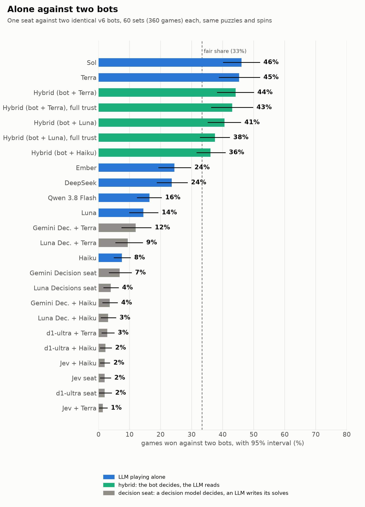
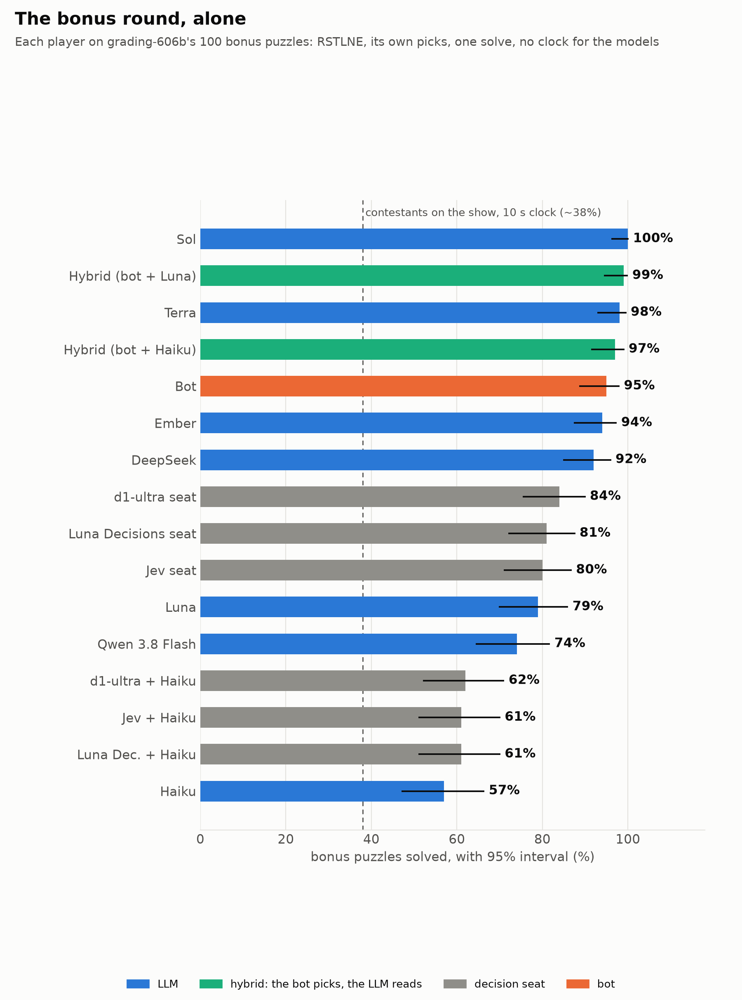
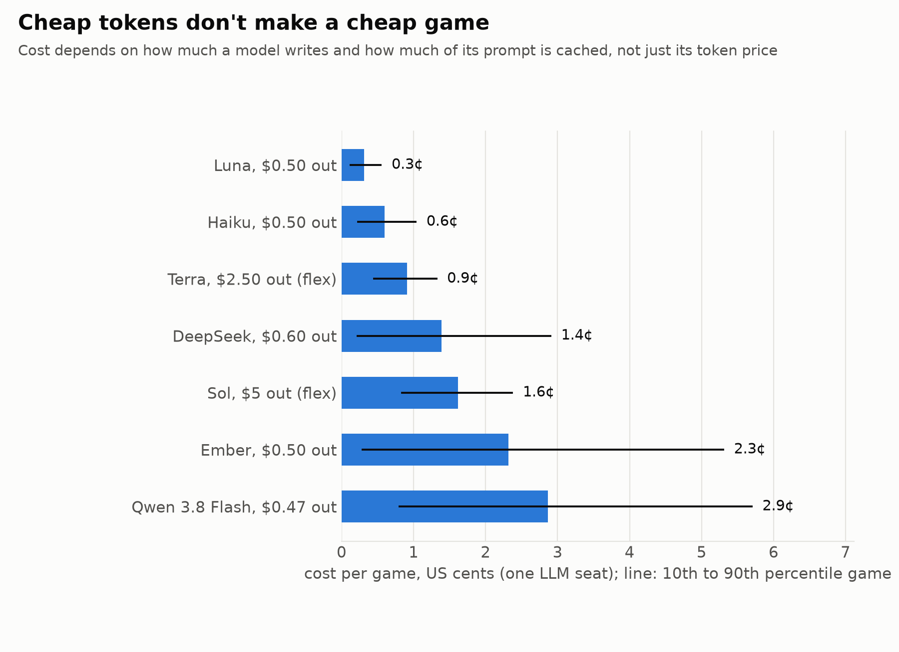

# Findings

Ian grew up watching *Wheel of Fortune* at dinner. When large language models arrived, he wondered whether one could play his childhood game show, how well, and whether we could build something that plays better. rstlne is a full Wheel of Fortune engine where language models, a hand-built bot, and mixes of the two play at the same table.

This page is the short version. The paper in [paper/](paper/) has the method and the detail, and every number below comes from `paper/numbers.json`, built by `python -m rstlne.analysis.numbers`.

Every result is from bot v6 on the grading-606b deck: 400 main-round puzzles in four round chunks, each matched to aired rounds 1 to 4 in category and length, and 100 bonus puzzles. MiniMax M3 wrote the puzzles and GLM 5.3 Flash judged them, so none can be in a model's training data. Each lineup played 60 sets of 6 games, one per seating order, on seed 707. A set replays the same puzzles and spins in every seating, so lineups compare set by set, and intervals are 95% from resampling whole sets. Seven models from five labs played 30 lineups, 10,800 games in all, for $71.16 in API calls.

## Can LLMs play it?

Yes. Every model finished every game through tool calls. The engine sends back a call it can't use, such as a consonant called before spinning, and the model tries again. GPT-6.1 Sol had 3 calls sent back in 360 games and Terra none. Qwen 3.8 Flash had the most, 1.07 a game.

Wrong solves split the strong readers from the weak. Of Luna's 229 wrong solves, 74% didn't fit the board, most often by putting a letter already called into a blank. Only 12% of Sol's 24 did.

## How well do they play?

One model sat alone against two copies of the bot. A player as good as the bot would win a third of the games.

| Alone against two bots | Wins | Solves right | Board showing at a right solve (median) | Wrong solves a game |
|---|---|---|---|---|
| GPT-6.1 Sol | 46.1% (40.3–51.9) | 97% | 50% | 0.07 |
| GPT-6.1 Terra | 45.3% (38.9–51.9) | 94% | 48% | 0.13 |
| Muse Ember | 24.4% (19.4–29.7) | 98% | 64% | 0.03 |
| DeepSeek V4.1 Flash | 23.6% (18.9–28.6) | 87% | 45% | 0.26 |
| Qwen 3.8 Flash | 16.4% (12.5–20.3) | 85% | 65% | 0.19 |
| GPT-6 Luna | 14.4% (10.0–19.2) | 71% | 48% | 0.64 |
| Claude Haiku 5.5 | 7.5% (5.0–10.3) | 93% | 70% | 0.07 |

Sol and Terra tie (Terra minus Sol, set by set: −0.8 points, −6.9 to +5.0), and they're the only models above a third. They're early and right at once. DeepSeek and Luna solve as early but are wrong more often. Ember, Haiku and Qwen are mostly right but wait until two-thirds of the board shows, and by then a bot usually has the round.

Sol and Terra win on boards the bot can't read yet. In 60% of their winning rounds, the bot's reader had the wrong answer or wasn't sure of the right one. Played on from those boards, the bot needed a median of 3 more letters called when it was right but unsure, and 5 to 6 when it was wrong. Their consonants hit 94% of the time, where the bot's reader expected 84–85% for the same letters.

Part of the bots' later solving is milking, not reading. A bot that won a round after it was sure of the answer was sure with a median 55% of the board showing and solved at 62%, spinning on for the leftover consonants in between. It won 79% of the 7,004 rounds it was sure in.

## Can we do better?

Yes, mostly. The bot alone beats five of the seven models, but not Sol or Terra.

In a hybrid the bot makes every move and, on its turns, asks a model whether it can solve the board and what the answer is. The bot handles the money, the risk, and when to solve; the model only reads.

| | Wins alone | Wins as a hybrid | Gain, set by set |
|---|---|---|---|
| Luna | 14.4% | 40.6% | +26.1 points (+19.2 to +32.8) |
| Haiku | 7.5% | 36.1% | +28.6 points (+23.3 to +33.9) |
| Terra | 45.3% | 44.2% | −1.1 points (−8.6 to +6.1) |

The lift works on two labs' models with opposite faults: the bot stops Luna from guessing early and makes Haiku act sooner. The Luna hybrid ties Sol (Sol minus the Luna hybrid: +5.6 points, −1.1 to +12.5). A strong reader gains nothing, so the bot's decisions set the ceiling.

Handing every choice to a decision model makes play worse. Four decision models from four labs (d1-ultra, GPT-6 Luna Decisions, Jev 1.14, Gemini Decision 1) won 1.9% to 6.8% of their games against two bots with Luna writing their answers. Luna alone beats the Luna Decisions seat by +10.6 points (+5.8 to +15.6). With Terra writing instead, the best pairing, Gemini Decision with Terra, wins 11.9%, a tie with Luna alone.

## Is the bot's strategy right?

Self-play tested one habit at a time, each variant against two copies of the unchanged bot, 1,002 games each on a separate tuning deck.

- Milking every known answer loses −14.2 points and banks $1,619 less a game. Solving the moment it's sure loses less, −3.9 points, and is wrong more often (94.7% of solves right, against 97.0%).
- Never buying a vowel loses −9.4 points. Buying vowels earlier, in three different ways, ties the bot.
- Calling the likeliest consonant ties the bot in wins (+1.0 points, −2.8 to +4.8) and is the only variant that banks clearly more money.

No variant wins more games than the bot.

## How would human contestants fare?

There were no human players in the main rounds, so the bonus round is the comparison. Contestants solved 37.76% of their bonus puzzles from 2007 to January 2014 (William Spaniel's count, [The New Republic, 2014](https://newrepublic.com/article/116732/wheel-fortune-strategy-how-win-gameshow)), with a 10-second clock. Our players had no clock and one answer.

| Bonus puzzles solved, alone | Our deck (of 100) | Aired 2013–2024, held out (of 100) |
|---|---|---|
| Sol | 100 | 98 |
| Terra | 98 | 98 |
| Ember | 94 | 90 |
| DeepSeek | 92 | 88 |
| Luna | 79 | 66 |
| Qwen 3.8 Flash | 74 | 65 |
| Haiku | 57 | 55 |
| The bot | 95 | 90 |
| Luna hybrid | 99 | 92 |
| Haiku hybrid | 97 | 93 |

Every model would beat the average contestant on the show's own puzzles. On the 15 bonus puzzles contestants solved with the fewest letters showing, given each contestant's own board, Terra solves 14 and Sol 13.

## Cost

Token price predicts little. Per game for one model seat, Luna cost 0.3¢, Haiku 0.6¢, Terra 0.9¢, DeepSeek 1.4¢, Sol 1.6¢ on OpenAI's half-price flex tier, Ember 2.3¢, and Qwen 3.8 Flash 2.9¢. Qwen lists at $0.47 per million output tokens, yet it was the dearest, because some of its moves think for thousands of tokens.

## Charts

All are in [figures/](figures/), drawn from the game logs by `figures/make_figures.py`.

| Chart | Shows |
|---|---|
| [1](figures/1-alone-against-two-bots.png) | Win rate of each player alone against two bots |
| [2](figures/2-temperament.png) | How early each player solves, and how often it's right |
| [3](figures/3-every-lineup.png) | Who won each lineup |
| [4](figures/4-rounds-and-banks.png) | Rounds won, and money per round won |
| [5](figures/5-cost-per-game.png) | Cost per game |
| [6](figures/6-bonus-test.png) | The bonus round, alone |
| [7](figures/7-finishing-places.png) | Finishing places |
| [8](figures/8-money-spread.png) | Money banked, game to game |
| [9](figures/9-gaps-between-places.png) | Gaps between places |
| [10](figures/10-leads-and-comebacks.png) | Holding a lead, and coming back |
| [11](figures/11-risk.png) | Bankrupts and wrong solves |
| [12](figures/12-puzzle-length.png) | Puzzle length: how much board each needs, and each player's gain on long puzzles |
| [13](figures/13-reading-gap.png) | What the bot's reader made of each board a model won on |

The rules, the bot and the hybrid are specified in [documentation.md](documentation.md), and [README.md](README.md) covers setup and commands.
