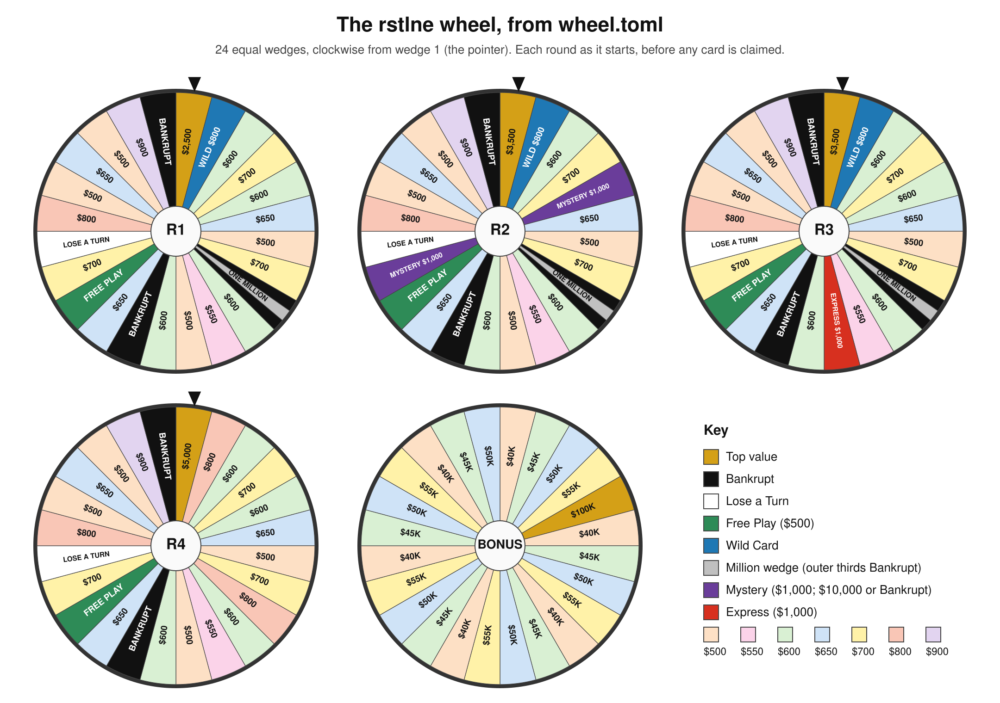

# The wheel

The wheel every game and tournament in this project plays, as set in `wheel.toml` on 2026-10-31. `documentation.md` (The wheel, Special wedges, Bonus round) has the full rules. `wheel.png` and `wheel.svg` are drawn from the engine's own layout of `wheel.toml`, so they show exactly what the games spin.

`wheel.svg` is the same drawing as a vector file.

## How it's built

- **24 equal wedges**, numbered clockwise from wedge 1, the round's top value.
- **Each wedge has three thirds**, so a spin lands on one of 72. Only the Million wedge plays its thirds differently: the two outer thirds are Bankrupt.
- **One base template** stays put. Special wedges sit on top of it, round by round, and cover the wedge beneath.

## Base template

| # | Wedge | # | Wedge |
|---|---|---|---|
| 1 | Top value | 13 | $600 |
| 2 | $800 | 14 | Bankrupt |
| 3 | $600 | 15 | $650 |
| 4 | $700 | 16 | Free Play |
| 5 | $600 | 17 | $700 |
| 6 | $650 | 18 | Lose a Turn |
| 7 | $500 | 19 | $800 |
| 8 | $700 | 20 | $500 |
| 9 | $800 | 21 | $650 |
| 10 | $600 | 22 | $500 |
| 11 | $550 | 23 | $900 |
| 12 | $500 | 24 | Bankrupt |

## Round by round

| Round | Top value | Wild Card | Million wedge | Mystery | Express |
|---|---|---|---|---|---|
| 1 | $2,500 | wedge 2 | wedge 9 | | |
| 2 | $3,500 | wedge 2 | wedge 9 | wedges 5 and 17 | |
| 3 | $3,500 | wedge 2 | wedge 9 | | wedge 12 |
| 4 and later | $5,000 | | | | |

The Wild Card and the Million wedge are on the wheel at the start of rounds 1 to 3 only while no seat holds that card, and they leave once claimed. The drawing shows each round before anyone claims anything.

## The special wedges

- **Wild Card (wedge 2, $800):** a correct consonant earns $800 and the card. Later, after a correct consonant on a plain dollar wedge, the holder can spend it on one extra consonant at the same value. Unspent, it gives a fourth consonant in the bonus round.
- **Million wedge (wedge 9):** the outer thirds are Bankrupt and the centre third plays as $500. A correct consonant on the centre takes the Million card, which is kept only by solving that round. In the bonus round it swaps the $100,000 envelope for $1,000,000. Once claimed, wedge 9 plays as a plain $800.
- **Mystery (round 2, wedges 5 and 17):** $1,000 per copy. After a correct consonant, keep the money, or flip for what's behind: $10,000 on one wedge, Bankrupt on the other. A seeded draw decides which.
- **Express (round 3, wedge 12):** $1,000 per copy. After a correct consonant, pass and play on normally, or ride: call consonants at $1,000 a copy and buy vowels at $250 with no spinning, until you solve. Any miss or wrong solve is Bankrupt.
- **Free Play (wedge 16):** call any letter. Consonants earn $500 a copy, vowels are free, and a miss keeps the turn.
- **Bankrupt (wedges 14 and 24)** zeroes the round bank and takes any held cards. **Lose a Turn (wedge 18)** passes the turn.

## What a spin is worth

Counted over the 72 thirds, as each round starts. Mystery and Express count at their $1,000 face value.

| Round | Bankrupt | Lose a Turn | Free Play | Average dollar wedge, per copy | Average per spin, with $0 for the rest |
|---|---|---|---|---|---|
| 1 | 1 in 9 (8 of 72) | 1 in 24 | 1 in 24 | $721 | $611 |
| 2 | 1 in 9 | 1 in 24 | 1 in 24 | $805 | $682 |
| 3 | 1 in 9 | 1 in 24 | 1 in 24 | $795 | $674 |
| 4 and later | 1 in 12 (6 of 72) | 1 in 24 | 1 in 24 | $848 | $742 |

Round 4 is the richest and safest: its top value is $5,000, and with the Million wedge gone only the two Bankrupt wedges are left.

## The bonus wheel

24 equal envelopes. The engine keeps the drawn envelope hidden until after the solve.

| Envelope | Count |
|---|---|
| $40,000 | 6 |
| $45,000 | 6 |
| $50,000 | 6 |
| $55,000 | 5 |
| $100,000 | 1, or $1,000,000 for a Million card holder |

The drawing spreads the values evenly around the bonus wheel, since the order doesn't matter: every envelope is equally likely.

## Where it differs from the show

These are deliberate choices, not mistakes:

- **The special wedges' positions** (Wild on 2, Million on 9, Mystery on 5 and 17, Express on 12).
- **The Million wedge** sits on an $800 wedge, and its centre third plays as $500.
- **Free Play stays on the wheel.** The show retired it in 2021.
- **The bonus envelope counts** (6, 6, 6, 5, 1).
